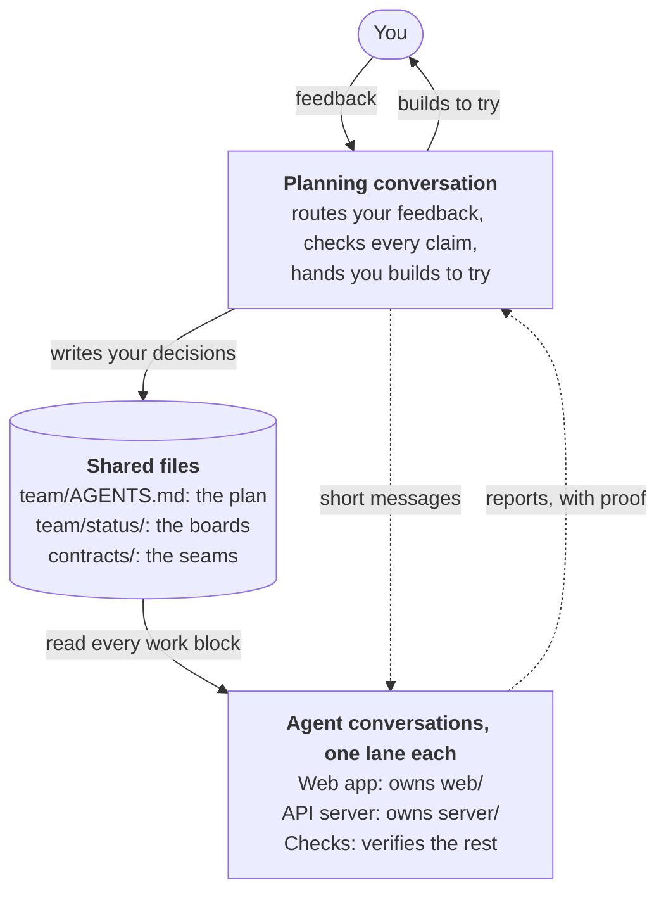
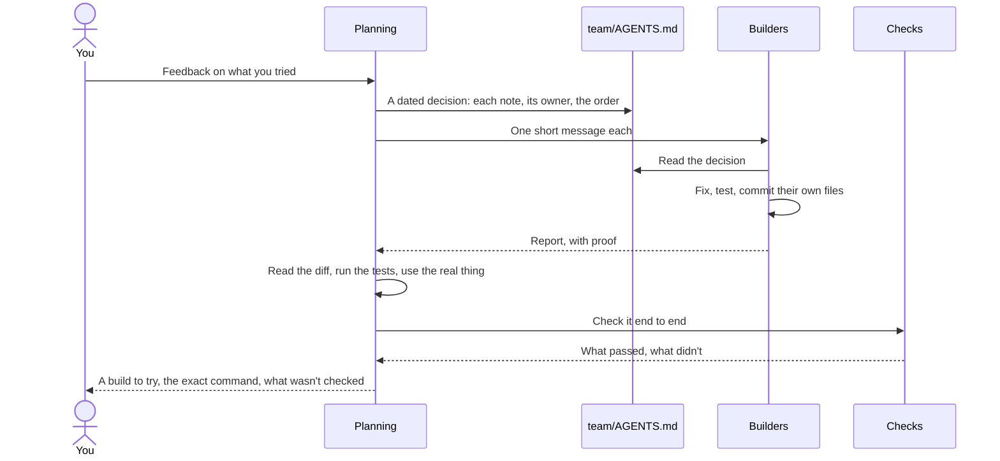
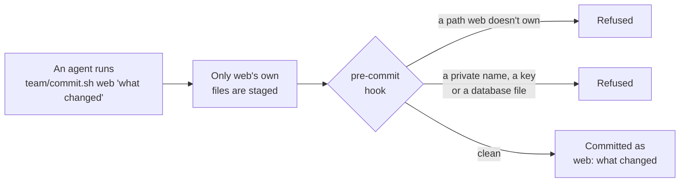

# multi-agent-build

A Claude Code skill for building one project with several Claude Code conversations at the same time.

Each builder agent owns its own part of the repo. A checks agent verifies the work. A planning conversation keeps the plan, turns your feedback into work for the right agents, and checks their claims before you hear about them. They share one folder and one branch on one Mac, and coordinate through files in the repo and messages between conversations.

## How it works

### Who does what

You talk only to the planning conversation. It writes each of your decisions into the plan, and every agent reads the plan at the start of each work block. Each agent works in its own lane: it changes and commits only the paths it owns.



### One round of your feedback

Nothing reaches you until it has been checked twice: once by the planning conversation, once by the checks agent.



### What every commit goes through

Agents share one folder, so one stray `git add -A` could sweep up another agent's work. Every commit goes through one script, and a hook refuses anything outside the agent's lane or anything private.



## Requirements

- Claude Code 2.1.224 or later, for messaging between conversations (2.1.234 or later on Windows).
- git, bash and python3 (3.9 or later).
- macOS or Linux. The scripts are bash and haven't been tried on Windows.

## Install

```bash
git clone https://github.com/mynamejoi/multi-agent-build ~/.claude/skills/multi-agent-build
```

New conversations then list the skill, and Claude loads it when you ask for a build like this. To update:

```bash
git -C ~/.claude/skills/multi-agent-build pull
```

## Use

In the conversation you want as the planning seat, describe the build. For example:

> Set up a multi-agent build in ~/code/habits: a phone-first web front end, an API server with SQLite, and a nightly summary job. First stage in a week.

Claude settles the shape with you, runs the scaffold, fills in the plan and the prompts, and gives you the list of conversations to start.

You can also run the scaffold yourself:

```bash
python3 ~/.claude/skills/multi-agent-build/scripts/scaffold.py ~/code/habits \
  --project "Habits" \
  --lane "web|Web app|web/" \
  --lane "api|API server|server/,scripts/,contracts/api.md" \
  --checks "checks|Checks|tests/" \
  --git-name "Your Name" --git-email "you@users.noreply.github.com"
```

A lane is `id|Title|paths`:
- the id is what that agent commits as;
- the title names its conversation (`Habits: Web app`);
- the paths are the only ones it may commit. A path ending in `/` covers everything under it, and no two agents may claim the same path.

The planning conversation gets its own name too (`Habits: Planning`), so agents can message it. Run the scaffold with `--help` for every option.

A few of the options matter for privacy:
- `--owner` puts a name into every file. Leave it out to write "the owner" instead.
- `--git-name` and `--git-email` set a git identity for this repo only. Without them, git builds an email from your Mac's user and host names and writes it into every commit.

Then, in the repo's folder:

1. Fill in every TODO, until `grep -rn TODO team contracts CLAUDE.md` finds none, and write each contract as a first sketch.
2. Add the names and details that must never reach the repo, one form at a time: the full name, the surname, the email and the part before its `@`. For example, `python3 team/gate.py add "First Last" --kind "a person's name"`. Then run `python3 team/gate.py --all`, which checks every file and says how many it checked.
3. Make the first commit as the owner: `git add CLAUDE.md .gitignore team contracts && TEAM_AGENT=owner git commit -m "Set up the multi-agent build"`.
4. Rename the planning conversation to its name, then start one conversation per agent in the repo's folder, all in the planning conversation's permission mode. Rename each one as the scaffold printed, and give it the first message `Read team/prompts/<id>.md and start.`

### Adding or removing an agent

Run the scaffold again with `--force` and every agent's `--lane`, plus `--remove <id>` for one you mean to drop. It refuses a list that would drop an agent silently. Then update the plan's agents table and the `CLAUDE.md` block by hand.

### A fresh clone

Hooks and the gate's settings live in `.git/config`, so a clone has neither. Run the scaffold in the clone with `--clone --project "Habits"`. It writes no files; it turns on the hooks and settings for that clone. Then add the private terms again on that machine.

## What the scaffold writes

| File | What it's for |
|---|---|
| `team/AGENTS.md` | The plan every agent reads first: your decisions (newest first), open questions for you, the agents, how the pieces fit, the contracts, the stack, the hard rules, the stages |
| `team/prompts/<id>.md` | Each agent's starting brief |
| `team/status/<id>.md` | Each agent's board: what it's doing, what's done with proof, requests, questions for you |
| `team/owners.txt` | Who may commit which paths |
| `team/commit.sh` | The only way agents commit: it stages and commits just their own files, and waits while another agent commits |
| `team/hooks/` | `pre-commit` refuses other agents' paths and runs the privacy gate on the files; `commit-msg` runs it on the message; `pre-push` lets only you push |
| `team/gate.py` | The privacy gate |
| `.gitignore` | Keeps virtual environments, caches, databases and env files out of every commit. An existing one only gains lines |
| `contracts/README.md` | How the seams between agents are owned and versioned |
| `CLAUDE.md` | A short block telling every conversation to read the plan and the boards first. An existing `CLAUDE.md` keeps its content |

It never overwrites the plan, a prompt, a status board or your `CLAUDE.md`. Running it again with `--force` refreshes the scripts, hooks and `owners.txt`, for a changed list of agents or a newer kit.

## What it enforces

- **Each agent commits only its own paths**, through `team/commit.sh`. A plain `git commit` is refused. You can commit anything with `TEAM_AGENT=owner git commit ...`.
- **Only you push**: `TEAM_AGENT=owner git push`.
- **The privacy gate runs on every commit's files and its message.** It refuses:
  - the private terms you add;
  - common API keys, tokens and private keys;
  - databases, env files and key files.
  
  The terms are stored as salted fingerprints in `~/.config/agent-team/`, outside the repo, so nothing in git names them. A line of made-up test data that looks private passes when it's marked `privacy-ok`, with its reason.

## What's in this repo

| Path | What it is |
|---|---|
| `SKILL.md` | What Claude reads: when to use this, how to set a build up, how to run it |
| `scripts/scaffold.py` | Writes the team files into a repo |
| `assets/` | The templates and scripts the scaffold copies. Edit them to change what every future build starts with |
| `references/planning-seat.md` | The planning conversation's routine: routing feedback, checking claims, handing over builds, messaging limits, and a watch loop that keeps agents moving |
| `references/lessons.md` | What went wrong in the first build, and what to do instead |
| `tests/test_kit.sh` | Tests the scaffold, the commit script, the hooks and the gate on throwaway repos |

## Messaging between conversations

From the [official docs](https://code.claude.com/docs/en/cross-session-messaging.md):

- Conversations on the same Mac find each other with ListAgents and message each other with SendMessage.
- An idle conversation starts a new turn to answer, and a busy one reads the message between steps.
- A message from another conversation can't approve anything or change settings.
- Keep every conversation in the same permission mode. A conversation that skips permission prompts holds messages from ones that don't, and the reverse. The Desktop app can't show the approval prompt, so a held message is dropped after five minutes.
- Rapid bursts to one conversation are refused, so send fewer, fuller messages.

## Test

```bash
bash tests/test_kit.sh
```
